# Modeling System Context

Model what lies inside the system boundary and what interacts with it from outside. Keep the trace chain visible from source and boundary item to classification, data flow, and DOT diagram.

**Material gaps:** When material ambiguity or conflicting terms block this artifact, invoke `grill-with-docs` alongside `srs-ai-resolving-requirements-gaps` to update the context ledger (pass gap/artifact IDs and evidence; reuse resolved answers; resume here after). Sufficient inputs proceed directly; persisted records supplement the response format below.

## Required Output

Produce these five sections in order:

### 1. System Boundary

Name the system and state what is inside the boundary in one or two sentences before writing tables or diagrams. When the prompt implies multiple boundaries, choose the smallest useful boundary, mark that choice as a provisional assumption, and list the alternatives in Unresolved Boundary Questions.

### 2. Classification Table

Account for every named item and every external system implied by integrations, upstream/downstream data, identity, payment, messaging, documents, analytics, compliance, storage, or support workflows. Determine each item's position relative to the declared boundary first:

| Item | Classification | Inside boundary? | Reason |
| --- | --- | --- | --- |

Allowed `Classification` values:
- `actor`: external person, role, group, organization, or team that uses, operates, approves, or is affected by the system.
- `external system`: software, hardware, service, API, database, platform, data source, or data destination outside the boundary.
- `internal component`: implementation part (service, queue, worker, API, database) inside the boundary; omit from the context diagram.
- `inside-scope capability`: behavior owned by the modeled system.
- `out-of-scope item`: known item intentionally outside the modeled context.
- `unresolved boundary item`: item whose ownership or boundary placement is uncertain and requires confirmation.

### 3. Input/Output Data-Flow Table

Capture every boundary-crossing data flow between the system and each actor or external system:

| Source | Target | Direction | Data flow | Trigger or frequency | Notes |
| --- | --- | --- | --- | --- | --- |

- Set `Direction` to `input`, `output`, or `bidirectional` from the system's perspective.
- Name business data, commands, events, documents, notifications, or decisions (include protocol details only when required by a constraint).
- Mark uncertain flows as questions in `Notes` and repeat them in Unresolved Boundary Questions.

### 4. DOT Context Diagram

Output a DOT diagram showing only boundary-crossing interactions:
- One cluster (`cluster_system`) for the system boundary.
- Actors and external systems outside the cluster; omit internal components, and show uncertain placement only as an explicitly labeled `unresolved boundary item`.
- Directed edges labeled with the data flows from the table.

```dot
digraph context {
  rankdir=LR;
  node [shape=box];

  subgraph cluster_system {
    label="System boundary: <System Name>";
    system [label="<System Name>", shape=box, style=filled];
  }

  actor [label="<Actor>", shape=oval];
  external [label="<External System>", shape=box];

  actor -> system [label="<input data flow>"];
  system -> external [label="<output data flow>"];
}
```

### 5. Unresolved Boundary Questions

List every uncertain boundary placement, ownership question, or unconfirmed flow (or write `None`).

## Quality Gate

Before returning, verify that every named or integration-implied item is classified relative to the declared boundary, every diagram node and edge reconciles with the Classification and Data-Flow tables, internal components are excluded from the diagram, and all uncertain placements or flows appear in Unresolved Boundary Questions.
