```dot
digraph context {
  rankdir=LR;
  node [shape=box];

  subgraph cluster_system {
    label="System boundary: <System Name>";
    system [label="<System Name>", shape=box, style=filled];
  }

  actor [label="<Actor>", shape=oval];
  external [label="<External System>", shape=box];

  actor -> system [label="<input data flow>"];
  system -> external [label="<output data flow>"];
}
```

# Modeling System Context

Use this skill to model what is inside the system under discussion and what interacts with it from outside. Keep the output at context level, not internal architecture level.
Keep the trace chain visible from boundary item to classification, flow, and diagram.

## Material Gaps

When material ambiguity or conflicting terminology blocks this artifact, use `grill-with-docs` for the interview. Read `srs-ai-resolving-requirements-gaps` for the requirements ledger and handoff rules alongside it. Pass existing gap IDs, evidence, and affected artifact IDs; reuse resolved answers. After the interview, resume this skill's output and quality gate. Sufficient inputs proceed directly; persisted records supplement the response format below.

## Core Rules

- State the explicit system boundary before writing tables or diagrams.
- Classify every named item as one of: actor, external system, internal component, inside-scope capability, out-of-scope item, or unresolved boundary item.
- Determine each item’s position relative to the declared boundary before assigning its classification. APIs, databases, services, and similar technical items can be internal components or external systems; use `unresolved boundary item` when ownership or placement is uncertain.
- Include external systems named or implied by integrations, upstream data, downstream data, identity, payment, messaging, documents, analytics, compliance, storage, or support workflows.
- Capture input and output data flow across the boundary.
- Produce the context diagram in DOT.
- List unresolved boundary questions instead of hiding ambiguity.

## Required Output

Produce these sections in order:

1. System Boundary
2. Classification Table
3. Input/Output Data-Flow Table
4. DOT Context Diagram
5. Unresolved Boundary Questions

## System Boundary

Name the system and state what is inside the boundary in one or two sentences. If the prompt implies multiple possible boundaries, choose the smallest useful boundary, mark that choice as provisional, and list alternatives in unresolved boundary questions.

## Classification Table

| Item | Classification | Inside boundary? | Reason |
| --- | --- | --- | --- |

Classification values:
- `actor`: external person, role, group, organization, or team that uses, operates, approves, or is affected by the system.
- `external system`: software, hardware, service, platform, data source, or data destination outside the boundary.
- `internal component`: implementation part inside the system; exclude from context diagram.
- `inside-scope capability`: behavior owned by the modeled system but not a separate actor or external system.
- `out-of-scope item`: known item intentionally outside the modeled context.
- `unresolved boundary item`: item that needs confirmation before it can be placed.

## Input/Output Data-Flow Table

| Source | Target | Direction | Data flow | Trigger or frequency | Notes |
| --- | --- | --- | --- | --- | --- |

Rules:
- Include each actor and external system that exchanges data with the system.
- Use `input`, `output`, or `bidirectional` from the system's perspective.
- Name business data, commands, events, documents, notifications, or decisions, not protocol details unless required.
- Mark unknown flows as questions in the notes and repeat them in unresolved boundary questions.

## DOT Context Diagram

Output a DOT diagram with:
- one cluster or clearly labeled node for the system boundary;
- actors and external systems outside that boundary;
- arrows labeled with data flows;
- internal components omitted; show uncertain placement only as an explicitly labeled unresolved boundary item.

Use this shape convention when possible:

## Quality Check

Before returning, account for every named or integration-implied item in the classification table. Apply the boundary and classification rules, reconcile every diagram node and edge with the tables, and record each uncertain placement or flow in Unresolved Boundary Questions (or write `None`).
