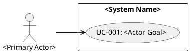

# Modeling Use Cases

Model actor goals and system responsibilities as traceable use cases from available FRs, system context, actors, business rules, and approved assumptions. Keep the trace chain visible from source FR to UC, flow, and diagram.

**Material gaps:** When material ambiguity or conflicting terms block this artifact, invoke `grill-with-docs` alongside `srs-ai-resolving-requirements-gaps` to update the context ledger (pass gap/artifact IDs and evidence; reuse resolved answers; resume here after). Sufficient inputs proceed directly; persisted records supplement the response format below.

## Required Output

Produce these five sections in order:

### 1. UC Register

| UC ID | Use case | Primary actor | Linked FR IDs | Trigger | Preconditions | Postconditions |
| --- | --- | --- | --- | --- | --- | --- |

- Assign stable IDs (`UC-001`, `UC-002`, or established project prefixes).
- Link every UC to one or more FR IDs. Where a needed UC lacks FR support, write `Missing - FR/context gap GAP-###` and record it in `FR/Context Gaps`.
- Name each UC as an actor goal (`Request Return`, `Schedule Appointment`, `Reset Password`); place UI elements, screens, clicks, APIs, jobs, tables, and internal components inside flows (only when needed for clarity) or in `FR/Context Gaps`.
- State one primary actor, trigger, preconditions, and postconditions for every UC.

### 2. Use-Case Details

```text
### UC-### - <Actor goal>
Linked FR IDs: <FR-###, FR-###>
Primary actor: <role/person>
Trigger: <event that starts the goal>
Preconditions: <state before the UC can start>
Postconditions: <state after success or controlled failure>

Main flow:
1. <actor intent or system responsibility>

Alternate flows:
A1 (from step #). <valid variation that still achieves or branches from the goal>

Error flows:
E1 (from step #). <failure condition, system response, and recovery or terminal outcome>
```

- Include all three flow sections (`Main flow`, `Alternate flows`, `Error flows`) for every UC. Where a flow type lacks support, link a `GAP-###`; where inapplicable, state the evidence-backed reason.
- Reference the originating main-flow step number on every alternate and error flow unless the condition applies globally.
- Express steps as meaningful actor/system interactions rather than raw UI click sequences.

### 3. PlantUML Use-Case Diagram

Provide a fenced `plantuml` diagram with actors outside the system boundary, UCs inside the boundary, actor-to-UC associations, and `include`/`extend` links only when they clarify required behavior:



### 4. FR Coverage Accounting

Account for every provided FR:

| FR ID | Coverage status | UC ID or disposition | Reason |
| --- | --- | --- | --- |

Allowed `Coverage status` values: `covered` (in at least one UC), `excluded` (intentionally outside UC scope, with reason), or `gap` (routed to `FR/Context Gaps` due to missing, conflicting, or uncertain context).

### 5. FR/Context Gaps

Record every UC, flow, actor, rule, precondition, postcondition, or diagram link that lacks FR/context support:

| Gap ID | Location | Missing or conflicting item | Send back to |
| --- | --- | --- | --- |

Name the upstream target in `Send back to` (`FR`, `system context`, `business rule`, `actor model`, or `stakeholder decision`).

## Quality Gate

Before returning, verify every UC against the Register, Details, and Diagram rules, reconcile diagram actors and UC IDs with the context and register, account for every provided FR in FR Coverage Accounting, and link every unsupported element to an entry in FR/Context Gaps.
